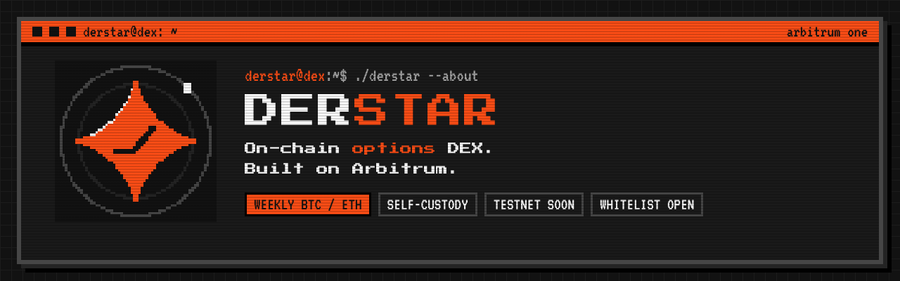

<p align="center">
  
</p>

<p align="center">
  <b>On-chain options DEX on Arbitrum.</b><br>
  Weekly BTC and ETH options · settled on-chain · testnet soon · whitelist open
</p>

---

## About

Derstar is a decentralized options exchange on Arbitrum One. Trade BTC and ETH options straight from your wallet. Every trade settles on-chain, and liquidity comes from vaults.

This repository is the **project website**: a static whitelist page in a pixel terminal style, plus a small serverless function that collects Arbitrum addresses for the whitelist.

| | |
|---|---|
| Markets | BTC and ETH, European, cash-settled, premium in USDC |
| Expiries | Weekly: three nearest Fridays, 08:00 UTC |
| Collateral | Calls: 1 WBTC / WETH per contract. Puts: strike in USDC |
| Liquidity | Protocol vault, template vaults, manager vaults (soon) |
| Status | Spec v0 done · frontend prototype in progress · contracts and testnet soon |

> Undecided parameters are marked **soon**.

## What's inside

```
.
├── index.html               # the whole site (HTML + CSS + JS, no build step)
├── api/
│   └── whitelist.js         # POST address → Upstash Redis; GET ?token= → CSV export
├── logo.svg                 # pixel logo
├── favicon-32.png
├── apple-touch-icon.png
├── og.png                   # link preview image
├── .github/assets/          # README banner and GitHub social preview
├── vercel.json
└── package.json
```

## Run locally

Open `index.html` in a browser. The whitelist form needs the API, so for that run:

```bash
npm i -g vercel
vercel dev
```

## Deploy

The site deploys to **Vercel** straight from this repo: every push to `main` goes to production, every other branch or pull request gets its own preview URL.

1. Vercel → **Add New → Project** → import this repository.
2. Framework preset **Other**, build command empty, output directory `.`.
3. **Storage → Upstash for Redis** → connect to the project (adds `KV_REST_API_URL`, `KV_REST_API_TOKEN`).
4. **Settings → Environment Variables** → add `ADMIN_TOKEN` (a long random string).
5. Redeploy.

## Whitelist

- Visitors submit an Arbitrum One address (`0x` + 40 hex). Addresses are lowercased and deduplicated.
- Rate limit: 10 submissions per IP per hour.
- Export all addresses as CSV: `https://derstar.xyz/api/whitelist?token=<ADMIN_TOKEN>`

## Links

Website · [derstar.xyz](https://derstar.xyz)  
Docs · soon  
X / Twitter · [@Derstar_options](https://x.com/Derstar_options)  
Discord · [discord.gg/yAawhGKQxP](https://discord.gg/yAawhGKQxP)

---

<sub>Options are complex: a buyer can lose the whole premium, a vault depositor the collateral behind options sold. Nothing here is investment advice.</sub>
